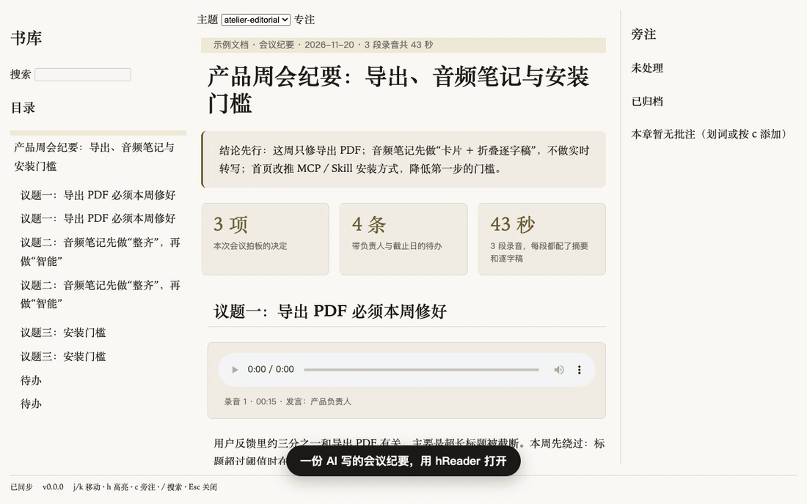
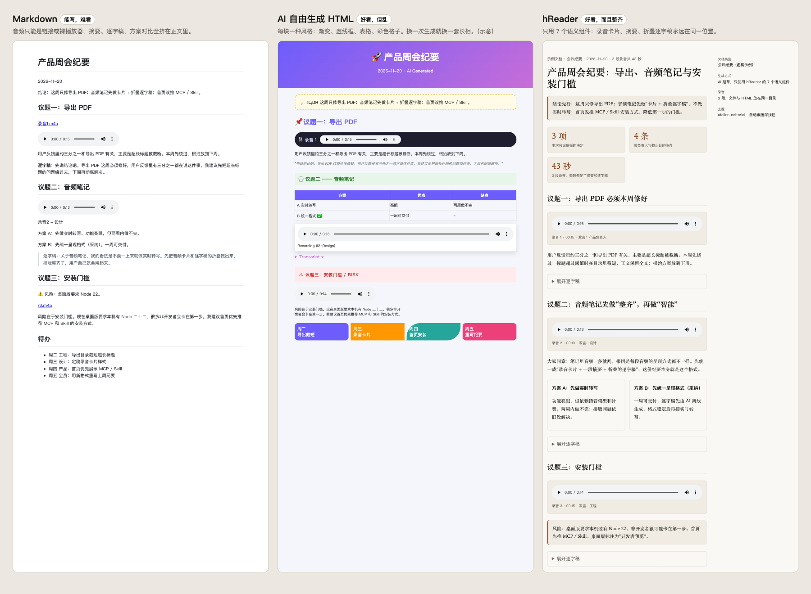

<div align="center">
  
  <h1>hReader</h1>
  <p><strong>AI Agent 的文档交付层：笔记、报告、纪要、简报、幻灯片，都是同一种整齐、可审、可局部修改的 HTML。</strong></p>
  <p>
    <a href="https://github.com/JingMox/hReader/releases"></a>
    <a href="https://github.com/JingMox/hReader/actions/workflows/ci.yml"></a>
    <a href="./LICENSE"></a>
    = 22" />
  </p>
  <p>
    <a href="https://jingmox.github.io/hReader/">在线示例库</a> ·
    <a href="https://jingmox.github.io/hReader/examples/why-html.html">为什么是 HTML</a> ·
    <a href="https://github.com/JingMox/hReader/releases">下载</a> ·
    <a href="./README.md">English</a>
  </p>
</div>

<p align="center">
  
</p>

<p align="center"><sub>选中一句话、写下批注 → Agent 通过 MCP 只改这一段 → 阅读器自动刷新，批注自动归档。</sub></p>

AI 写 HTML 和写 Markdown 一样便宜，但它排版太自由，每次都不一样。hReader 用 **8 个语义组件 + 一套主题**约束 AI 的排版，并在**写入时检查**这套约束；用**稳定的块 id** 让 Agent 只改你批注的那一段。每份文档都是你硬盘上一个普通的 `.html` 文件，双击就能打开，任何 Agent 都能读写。

它不只是笔记工具。Agent 交付给人的东西——周报、调研报告、会议纪要、决策简报、汇报用的幻灯片——都可以是同一种格式：

| 形态     | 一条命令起稿                        | 骨架                                                        |
| -------- | ----------------------------------- | ----------------------------------------------------------- |
| 笔记     | `hr new note.html`                  | 自由展开                                                    |
| 报告     | `hr new q4.html --kind report`      | 结论 → 关键数据 → 分析 → 方案对比 → 风险 → 下一步           |
| 会议纪要 | `hr new weekly.html --kind minutes` | 结论与决定 → 讨论要点 → 待办 → 录音与逐字稿                 |
| 决策简报 | `hr new brief.html --kind brief`    | 建议 → 依据 → 代价与风险 → 下一步                           |
| 幻灯片   | `hr new deck.html --kind slides`    | 每个 `<section>` 一页，滚动翻页，打印是横版一页一张，零脚本 |

## 一分钟试用

推荐从 MCP 或 Agent Skill 开始（需要 Node.js 22+）。

**MCP**（Claude Desktop、Cursor 等）：从 [Releases](https://github.com/JingMox/hReader/releases) 下载 `hreader-mcp-server.tar.gz` 并解压，然后在 MCP 配置里加上：

```json
{
  "mcpServers": {
    "hreader": {
      "command": "node",
      "args": ["/path/to/hreader-mcp-server/dist/main.js", "--workspace", "/path/to/your/docs"]
    }
  }
}
```

**Agent Skill**（Claude Code 等）：下载 `hreader-skill.zip`，解压到 Agent 的 skills 目录：

```bash
unzip hreader-skill.zip -d ~/.claude/skills/
```

然后对 Agent 说：“用 hreader 把这次会议整理成一份纪要。”

## 同一份内容，三种写法

<p align="center">
  <a href="https://jingmox.github.io/hReader/compare/"></a>
</p>

左边是 Markdown：音频只能是链接或裸播放器。中间是让 AI 自由生成的 HTML：好看，但每块一种风格，换一次生成就换一套长相。右边是 hReader：同样的内容，录音卡片、摘要、折叠逐字稿永远在同一个位置。[在线查看 →](https://jingmox.github.io/hReader/)

## 为什么是 HTML，而不是 Markdown

- **Markdown 赢在“不让你排版”**：过去排版成本由人出，所以大家选了表现力最弱、成本最低的格式。
- **AI 把这份成本付掉了**：对 AI 来说写 HTML 和写 Markdown 一样便宜，卡片、对比、折叠、音视频、图表都是白送的。
- **但 AI 排版太自由**：十份文档十种样子，放进一个资料库比 Markdown 还乱。所以需要约束：组件只声明语义（`data-hr-component="callout-warning"`），长相交给主题，换主题不动正文。
- **改，而不是重写**：每个块都有稳定的 `data-hr-id`，Agent 先看大纲（`hr_outline`）、只读一块（`hr_read_node`）、只改一块（`hr_patch_node`），原子写入、可撤销（`hr_undo`）。
- **文件是你的**：本地 `.html`，不绑定任何 AI 厂商；Claude Code、Cursor、Codex、DeepSeek 等任何支持 MCP 或 Skill 的 Agent 都能用。

完整论述见[《AI 时代，笔记为什么该用 HTML，而不是 Markdown》](https://jingmox.github.io/hReader/examples/why-html.html)。

## 现状

v1.0 刚刚开源，还很早期：组件目前 8 个、主题 1 套；排版约束已经在写入时检查（`hr check`、`hr patch` 回执里的 `warnings`），但只警告、不拒写；幻灯片形态目前是独立文件在浏览器里的体验，阅读器内的演示模式和 `hr pdf` 的横版导出还没做；桌面版需要本机有 Node 22，安装包还没签名。路线图上的下一步是更多主题、Markdown 导入和受控的交互组件。欢迎在 [Issues](https://github.com/JingMox/hReader/issues) 告诉我你想往文档里插什么。

---

## 桌面端工作台 (`hReader`)

基于 **Tauri v2** + TypeScript / Rust 构建，安装包内置独立 CLI（`cli.mjs` + `styles/`）与阅读器前端资源（`packages/app/dist/`）。

### 支持平台与安装包（[GitHub Releases](https://github.com/JingMox/hReader/releases)）

| 平台        | 架构                                   | 发布产物              |
| ----------- | -------------------------------------- | --------------------- |
| **macOS**   | Apple Silicon (`aarch64-apple-darwin`) | `.dmg`, `.app.zip`    |
| **macOS**   | Intel (`x86_64-apple-darwin`)          | `.dmg`, `.app.zip`    |
| **Windows** | x64 (`x86_64-pc-windows-msvc`)         | `.msi`, `.exe` (NSIS) |
| **Linux**   | x64 (`x86_64-unknown-linux-gnu`)       | `.deb`, `.AppImage`   |

### 运行前提与首次启动说明

- **Node.js `>= 22`**：需要安装在 `PATH`（或 nvm / fnm / Volta / Homebrew / Program Files 默认路径）中，用于运行内置本地服务与 CLI（`cli.mjs`）。
- **Google Chrome / Microsoft Edge / Chromium**（可选）：仅在使用 **导出 PDF**（`hr pdf`）与 **导出 PNG**（`hr png`）时需要。
- **未签名安装包首次打开方式**（`v1.1.0` 暂未购买 Apple / EV 签名证书）：
  - **macOS**：右键 `hReader.app` -> **打开**，或在终端运行 `xattr -dr com.apple.quarantine /Applications/hReader.app`。
  - **Windows**：在 SmartScreen 提示中点击 **更多信息 -> 仍要运行**。
  - **Linux**：运行 `.AppImage` 前先执行 `chmod +x *.AppImage`，或直接安装 `.deb` 包。

### 工作台核心特性

- **Typora + Obsidian 融合布局**：macOS 无割裂 Overlay 标题栏（`hiddenTitle`），通高可折叠 Vault 递归文件夹树（`scan_workspace_tree`），点击文档自动切换到 `OUTLINE` 大纲；居中的阅读/编辑画布与右侧批注抽屉。
- **空白工作区空状态页面**：打开一个尚无 `.html` 文档的空文件夹（或首次启动无文档）时，优雅进入空状态页，提供 **新建示例笔记**、**打开 HTML 文档** 与 **切换工作区文件夹** 入口，不报错也不偷偷写入未授权文件。
- **悬停显隐底部工具栏**：阅读时默认隐藏做到零干扰，鼠标靠近底部边缘自动浮现；可在设置中一键切换 **悬浮毛玻璃胶囊 (`floating`)** 或 **通栏滑入工具条 (`bar`)**。
- **多外观模式与用户自定义 JSON 主题**：默认 **纯净原生白 (`ui:light`)**，内置 **暖纸典藏 (`ui:paper`)** 与 **深色静谧 (`ui:dark`)**，并支持从 `~/.hreader/themes/*.json` 与 `<workspace>/.hreader/themes/*.json` 热加载用户自定义主题。
- **原生菜单与完整写作工具链**：双击/快捷键编辑块 HTML、段落与标题标签切换（`p` / `h1`–`h3` / `blockquote`）、插入 7 类语义化组件、快照撤销、源码模式、专注模式、PDF / PNG / 打印版 HTML 导出。

### 快捷键一览

| 功能                          | 快捷键（`macOS` / `Win & Linux`） |
| ----------------------------- | --------------------------------- |
| 新建文档                      | `Cmd/Ctrl + N`                    |
| 快速切换文档                  | `Cmd/Ctrl + O`                    |
| 从访达 / 文件管理器打开 HTML  | `Cmd/Ctrl + Shift + O`            |
| 打开工作区文件夹              | `Cmd/Ctrl + Alt + O`              |
| 立即保存                      | `Cmd/Ctrl + S`                    |
| 系统打印                      | `Cmd/Ctrl + P`                    |
| 编辑当前选中块 HTML           | `Cmd/Ctrl + E`                    |
| 打开语义组件面板              | `Cmd/Ctrl + Shift + K`            |
| 撤销文档快照                  | `Cmd/Ctrl + Shift + Z`            |
| 显隐左侧边栏（文件树 / 大纲） | `Cmd/Ctrl + Shift + L`            |
| 显隐右侧批注抽屉              | `Cmd/Ctrl + Shift + R`            |
| 切换源码模式                  | `Cmd/Ctrl + /`                    |
| 专注模式                      | `Cmd/Ctrl + Shift + F`            |
| 刷新窗口视图                  | `Cmd/Ctrl + R`                    |
| 偏好设置                      | `Cmd/Ctrl + ,`                    |

### 自定义外观主题（JSON 配置）

将 `.json` 文件放到 `~/.hreader/themes/`（全局生效）或 `<workspace>/.hreader/themes/`（仅当前工作区生效，同 `id` 覆盖全局）。也可以在菜单栏点击 **主题 -> 打开自定义主题目录…**，会自动生成可直接改写的 `nord-example.json` 示例：

```json
{
  "id": "nord-slate",
  "name": "Nord Slate",
  "base": "dark",
  "vars": {
    "--hr-paper": "#1d222b",
    "--hr-bg": "#1d222b",
    "--hr-fg": "#e5e9f0",
    "--hr-ink": "#eceff4",
    "--hr-accent": "#88c0d0",
    "--hr-rule": "#2e3440",
    "--hr-border": "#2e3440",
    "--hrd-panel-bg": "#171b22",
    "--hrd-sb-bg": "rgba(23, 27, 34, 0.92)",
    "--hrd-guide": "#323946",
    "--hrd-card-bg": "#242933"
  },
  "css": ""
}
```

### 从源码构建桌面端

环境依赖：**Node.js `>= 22`**、**pnpm `11`**、**Rust `1.98.0`**（通过 `rust-toolchain.toml` 自动锁定）。Linux 额外需要 WebKitGTK 系统开发库（`libwebkit2gtk-4.1-dev libgtk-3-dev libayatana-appindicator3-dev librsvg2-dev patchelf libssl-dev`）。

```bash
pnpm install --frozen-lockfile
pnpm build
pnpm desktop:build
```

---

## 命令行工具 (`hr`)

`@hreader/cli` 可编译为单文件独立包（`packages/cli/dist/cli.mjs` + `styles/`，Release 中同时提供 `hreader-cli.tar.gz`）。

```bash
# 按文档形态起稿（带齐 id、已套主题、组件占位齐全）
hr new report.html [--kind note|report|minutes|brief|slides] [--title <标题>] [--force]

# 查看文档结构与待处理批注
hr outline report.html [--json]

# 注入确定性 data-hr-id 节点锚点
hr normalize report.html --write [--json]

# 按 CSS 选择器或 data-hr-id 读取单节点
hr read report.html s2-p1 [--json] [--max-bytes 65536]

# 精准节点修补 (replace | insert_before | insert_after | append | delete)
hr patch report.html s2-p1 --action replace --html-file patch.html [--json]

# 排版约束检查：组件结构、内联 style、文档级诊断（只读）
hr check report.html [--json]

# 视觉排版 / 写作口吻提示词 / 禁用词检查 / 从语料抽取 style.yaml
hr style report.html --visual atelier-editorial
hr style report.html --tone atelier-editorial
hr style report.html --lint
hr style extract sample1.md sample2.md --id my-voice --out .hreader/style.yaml [--no-llm]

# 撤销最近一次落盘快照
hr undo report.html [--json]

# 导出与渲染
hr export report.html --visual atelier-editorial --out print.html [--force]
hr pdf report.html --out report.pdf [--page-size a4|letter|a5] [--visual <id>] [--force]
hr png report.html --out report.png [--width 256..4096] [--scale 1..3] [--visual <id>]

# 启动支持 SSE 热刷新的本地阅读服务
hr serve report.html [--workspace <dir>] [--port <n>]
```

退出码约定：`0` 成功，`1` 业务/校验错误，`2` 用法错误或需先 `normalize`，`3` IO 或越界路径错误，`70` 内部异常。

---

## 插件与 AI Agent 集成

详细接入配置见 [插件与 Agent 集成指南](./docs/06-plugins-and-integrations.md)。

### 1. MCP Server (`@hreader/mcp-server`)

打包输出 `packages/mcp-server/dist/main.js` + `styles/`（Release 中提供免安装 `hreader-mcp-server.tar.gz`，有 Node 22+ 即可直接启动）。

- **7 个工具**：`hr_outline`、`hr_read_node`、`hr_create_doc`、`hr_patch_node`、`hr_apply_style`、`hr_resolve_annotation`、`hr_undo`
- **Prompt**：`use-hreader-style`
- **传输协议**：
  - `stdio`（适用于 Claude Desktop、Cursor、Antigravity 等）：`node /path/to/hreader-mcp-server/dist/main.js --workspace /path/to/your/docs`
  - `Streamable HTTP`：`node /path/to/hreader-mcp-server/dist/main.js --http 3000 --workspace /path/to/your/docs`

> 建议始终显式传入 `--workspace <dir>`，避免部分客户端从 `/` 或 `$HOME` 启动服务进程导致工作区边界回退。

```json
{
  "mcpServers": {
    "hreader": {
      "command": "node",
      "args": ["/path/to/hreader-mcp-server/dist/main.js", "--workspace", "/path/to/your/documents"]
    }
  }
}
```

### 2. 独立 Agent Skill (`skills/hreader/`)

生成自包含 Skill 目录（`release-artifacts/hreader-skill/`，Release 提供 `hreader-skill.tar.gz` 与 `hreader-skill.zip`），内置 `SKILL.md`、组件/风格参考文档、`scripts/hr.mjs`、`scripts/cli.mjs` 与 `scripts/styles/`。

```bash
pnpm skill:pack
node release-artifacts/hreader-skill/scripts/hr.mjs outline /path/to/doc.html
```

将解压后的 `hreader-skill/` 放入任意兼容 Agent Skills 的目录即可使用；`scripts/hr.mjs` 会优先调用同目录内置的 `cli.mjs`。

### 3. Pi Coding Agent 扩展 (`packages/pi-extension`)

单文件扩展 [`packages/pi-extension/pi-hreader.ts`](packages/pi-extension/pi-hreader.ts)，提供 `/hreader <path>`、`/hr-style` 与基于 SSE 批注事件的会话上下文自动注入。

### 4. DeepSeek Harness 插件 (`packages/dsh-bundle`)

Cordis 插件 [`packages/dsh-bundle/src/index.ts`](packages/dsh-bundle/src/index.ts)，在宿主启动时自动将 `hreader` 写作规约编织进 `systemPrompt.section` 并暴露强类型文档服务。

---

## 工程结构

| 包路径                   | 职责                                                                              |
| ------------------------ | --------------------------------------------------------------------------------- |
| `@hreader/core`          | 语义化 HTML 解析、`data-hr-id` 树、大纲、精准修补、风格编译器与本地 HTTP/SSE 服务 |
| `@hreader/renderer-html` | 基于无头 Chromium 的 PDF / PNG / 打印版 HTML 导出渲染器                           |
| `@hreader/app`           | 桌面端与浏览器共用的阅读/批注交互前端（`dist/`）                                  |
| `@hreader/cli`           | 独立 `hr` 命令行与本地 daemon 服务                                                |
| `@hreader/desktop`       | Tauri v2 桌面壳（Rust 原生菜单、工作区树、自研工作台脚本与打包）                  |
| `@hreader/mcp-server`    | 独立 MCP Server（`stdio` & Streamable HTTP）                                      |
| `@hreader/pi-extension`  | Pi Coding Agent 集成扩展                                                          |
| `@hreader/dsh-bundle`    | DeepSeek Harness（Cordis）插件包                                                  |
| `skills/hreader`         | 跨宿主独立 Agent Skill                                                            |

---

## 开发与质量门禁

仓库对所有源码实施严格的 ESLint 规则、Prettier 格式校验、`vitest` 100% 覆盖率（statement / branch / function / line）、`dependency-cruiser` 零环依赖校验、`knip` 零死代码校验以及 Rust `clippy -D warnings`。

```bash
# 安装依赖
pnpm install

# 完整 10 步 JS/TS CI 门禁
pnpm verify

# Rust 桌面壳检查（cargo fmt + clippy -D warnings + 全部 Rust 单测与集成测试）
pnpm desktop:check

# 可选：打印渲染 E2E 测试（需本机 Chrome/Edge/Chromium）与 Pi 扩展冒烟测试
pnpm test:e2e
pnpm smoke:pi
```

---

## 相关文档

- [English README](./README.md)
- [插件与 Agent 集成指南](./docs/06-plugins-and-integrations.md)
- [更新日志 (CHANGELOG)](./CHANGELOG.md)
- [贡献指南 (CONTRIBUTING)](./CONTRIBUTING.md)
- [安全策略 (SECURITY)](./SECURITY.md)
- [桌面端实现说明](./packages/desktop/README.md)
- [CLI 退出码表](./packages/cli/README.md#exit-codes)

---

## 开源协议

[MIT](./LICENSE) © 2026 hReader Contributors
