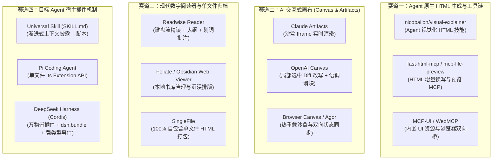

# hReader 竞品全景调研与“百家之长”分析报告

> [!NOTE]
> **调研目标**：围绕“设计一款 AI 原生 HTML 阅读器，并提供 Skill、MCP、Pi 插件、DeepSeek Harness 插件来编辑 HTML，内置一种默认风格且支持自定义语言风格”的产品构想，对当前行业内的 **AI 视觉生成工具、交互式画布、现代数字阅读器、以及主流 Agent 插件架构** 进行深度摸底与基因提炼。

---

## 一、 评估维度与当前生态的核心断层

在 AI Agent 逐渐成为主力内容生产与知识消化工具的今天，围绕 HTML 的“生产—编辑—阅读—批注—再创作”链路存在四个明显的生态断层：

1. **生成端与阅读端割裂**：AI 生成 HTML 往往只当作“一次性预览产物”（用系统浏览器打开即忘），缺少像专业阅读器那样的本地书库归档、目录大纲（TOC）导航、沉浸式排版调节与页边批注能力。
2. **全量重写与局部精修割裂**：HTML 标签冗余度高，Agent 直接全量读写 `.html` 文件极度消耗上下文 Token 且容易破坏标签闭合；现有工具普遍缺乏针对 HTML 语义节点（DOM Node）的**骨骼索引与手术刀式增量 Patch 协议**。
3. **视觉样式与语言文风割裂**：现有工具要么只管 CSS 样式美化（如主题模板），要么只管文本 Prompt，没有将**“视觉设计系统（Visual Design Tokens）”**与**“语言行文风格（Language / Prose Style）”**封装为统一、可插拔、可复用的风格包（Style Pack）。
4. **跨 Agent 宿主生态割裂**：不同开发者使用 Claude Code / Antigravity（依赖 Skill & MCP）、Pi Coding Agent（依赖单文件 TS Extension）、DeepSeek Harness（依赖 Cordis 插件树 `dsh.bundle`），缺乏一套“统一内核、多端原生适配”的 HTML 读写中间件。

---

## 二、 四大核心赛道竞品深度剖析

我们将竞品拆解为四个象限，逐一分析其核心机制、闪光点与局限性：

---

### 赛道一：Agent 原生 HTML 生成与 MCP 工具链

#### 1. `nicobailon/visual-explainer`（最接近生成端理念的明星开源 Skill）
* **核心机制**：针对终端 Coding Agent（Claude Code、Pi、Cursor 等）输出复杂表格、架构图、代码 Diff 时 ASCII 字符难以阅读的痛点，通过一套结构化 Prompt 与脚本引导 Agent 直接生成自包含（Self-contained）的本地 HTML 页面并在浏览器打开。
* **核心亮点**：
  * **视觉寄存器（Visual Registers）**：内置了 `Blueprint`（工程蓝图风）、`Editorial`（社论杂志风）、`Paper`（学术论文风）、`Instrument`（精密仪表风）等预设美学规范，彻底摆脱千篇一律的 AI 默认紫蓝渐变风。
  * **智能触发阈值**：定义了清晰的触发边界（如当表格超过 4 行 × 3 列，或涉及多步架构流转时自动转用 HTML 渲染）。
  * **富组件内嵌**：原生整合 Mermaid.js、内联 SVG 与响应式 CSS Grid。
* **局限性（hReader 的机会点）**：
  * **无专用阅读器宿主**：仅把 HTML 丢给系统默认浏览器，缺乏目录导航、书库管理、阅读进度与主题动态切换。
  * **单向一次性输出**：在浏览器里看到某段不满意，无法直接在页面上划词批注并一键唤醒 Agent 修改对应 DOM 节点。
  * **偏重视觉而弱化“语言风格定制”**：重点在于 CSS 视觉模板，缺乏用户自定义行文语调、叙事结构与禁用词表的独立配置层。

#### 2. `fast-html-mcp` & `seanivore/mcp-file-preview`
* **核心机制**：专为 LLM 读写本地 HTML 文件设计的 MCP Server。
* **核心亮点**：
  * `fast-html-mcp` 提供了面向 Token 优化的 `read_html`（剥离冗余样式/脚本，仅提取文本或结构）与局部 Patch 思路。
  * `mcp-file-preview` 允许 Agent 调用无头浏览器对本地 HTML 进行渲染截图与标题/段落结构分析，实现视觉自检。
* **局限性**：仅停留在底层 MCP 工具层，没有配套的前端阅读器交互界面，也不支持阅读器向 Agent 反向发起编辑事件。

#### 3. `MCP-UI` (`@mcp-ui/*`) 与 `WebMCP` (`@mcp-b/webmcp-local-relay`)
* **核心机制**：
  * `MCP-UI` 允许 MCP Server 在返回工具结果时附带 `_meta.ui.resourceUri`，支持客户端直接在对话流内渲染沙盒 HTML 视图。
  * `WebMCP` 则通过本地 WebSocket 中继桥，将浏览器页面内的交互动作暴露为本地 MCP 客户端可感知的工具与事件。
* **启发**：hReader 的本地同步桥可以借鉴 `WebMCP` 的双向 WebSocket 架构，同时在 MCP Server 中兼容 `MCP-UI` 协议。

---

### 赛道二：AI 交互式画布 (Canvas & Artifacts)

#### 1. Claude Artifacts
* **核心机制**：对话流中识别独立产物标签，在右侧分屏启动高度隔离的沙盒 `iframe` 实时渲染 HTML/SVG/React，并维护版本历史（v1, v2...）。
* **核心亮点**：流式预览反馈极快；单文件自包含概念深入人心；支持版本回退。
* **局限性**：闭源且绑定云端聊天窗口；不支持跨会话的本地文档书库沉淀；早期以整文件重新生成为主，长文档修改慢且费 Token。

#### 2. OpenAI Canvas (Writing & Code)
* **核心机制**：专为长文协同写作与代码打磨设计的并排工作台，底层采用针对选区（Selection）的 Differential Patch 引擎。
* **核心亮点**：
  * **“划词即改”交互范式**：用户用鼠标框选任意段落，即可弹出浮动输入框要求 AI 局部扩写、精简或重写，其余段落纹丝不动。
  * **内置风格调节器**：提供快捷滑块调整阅读难度（Reading Level，从幼儿园到研究生）与篇幅长度，并提供行内修改建议（Inline Suggestions，类似 Word 审阅模式）。
* **局限性**：主要面向纯文本/Markdown 和代码片段，不支持富排版 HTML DOM 结构的语义块可视化编辑与自定义设计系统注入。

---

### 赛道三：现代数字阅读器与单文件归档工具

#### 1. Readwise Reader & Foliate
* **核心机制**：Readwise Reader 是目前公认体验天花板级的现代数字阅读器；Foliate 是 Linux/跨平台极受欢迎的开源电子书阅读器。
* **核心亮点**：
  * **人体工学排版控制**：严格控制最佳行宽（60~75 字符）、字号、行高、段间距，提供无感切换的纸张色/暗夜色主题。
  * **键盘流与结构化大纲**：支持 `j`/`k` 逐段聚焦阅读（Focus Mode），自动解析 H1~H6 生成常驻动态目录树（TOC）。
  * **高亮与页边批注（Margin Notes）**：划词高亮极为顺滑，批注直接显示在正文右侧的留白旁注栏（Sidenotes），符合纸质书批阅直觉。
* **局限性**：它们是纯粹的“只读消费端（Read-only Consumer）”。用户写下的批注只能导出为 Markdown 笔记，无法点击批注直接驱动 AI 修改原 HTML 正文。

#### 2. SingleFile (Web Archive Standard)
* **核心机制**：将复杂网页的所有外部 CSS、字体子集、SVG、图片通过 Base64 或内联 `<style>` 打包进唯一一个 `.html` 文件中。
* **启发**：hReader 生成或导出的文档应当继承这种 **100% 单文件自包含基因**——甚至连用户的划词高亮、批注和当前使用的风格元数据，都可以存储在 HTML 内部的 `<script id="hr-meta" type="application/json">` 标签中，确保单文件拷走即用、永不丢失批注。

---

### 赛道四：目标 Agent 宿主插件架构调研

为了实现“一套内核，同时赋能 Skill、MCP、Pi、DeepSeek Harness”，我们深入调研了这四大宿主的扩展机制：

| 宿主平台 | 扩展核心机制 | 优势与特色 | hReader 集成切入点 |
| :--- | :--- | :--- | :--- |
| **Universal Skill** (Claude Code / Antigravity) | `SKILL.md` + `references/` + `scripts/` 渐进式上下文加载 | 零配置跨平台通用；通过自然语言规约指导 LLM 生成高质量结构 | 在 `SKILL.md` 注入内置语义组件模板；在 `references/` 按需加载自定义语言风格；提供 `hr-cli` 脚本执行 DOM Patch |
| **MCP 协议** (通用客户端) | JSON-RPC Tools + Prompts + Resources + `MCP-UI` | 工业界标准工具调用协议，天然支持跨进程状态维护 | 将 DOM 骨骼读取、局部节点替换、批注读取暴露为标准 Tool；将语言风格暴露为 MCP Prompt |
| **Pi Coding Agent** (`pi.dev`) | **单文件 `.ts` Extension** (`@earendil-works/pi-coding-agent`)，无需编译直接加载 | 极简内核，支持 `pi.registerCommand`、`pi.registerTool` 与 `context.ui` 终端交互 | 提供单文件 `pi-hreader.ts`，注册 `/hreader` 与 `/style` 命令，将阅读器划词事件通过 `context.ui` 注入 Pi 上下文 |
| **DeepSeek Harness** (`dsh` / Cordis) | **“万物皆插件” (Everything is a Plugin)**，基于 **Cordis** 时空可组合内核与 `dsh.bundle` | 无特权内核，所有 Agent Loop、Prompt、Tool、Web 界面均为 Cordis 插件，支持可逆卸载（Reversible Effects）与强类型事件 | 封装 `@hreader/dsh-bundle`（含 `cordis.patch.yml`），向 Cordis 注册 `hreader` 服务、动态织入语言风格 Prompt Hook，并在 `dsh-web-app` 内嵌阅读器分屏面板 |

---

## 三、 竞品全景对比矩阵

| 核心能力指标 | `visual-explainer` | Claude Artifacts | OpenAI Canvas | Readwise Reader | `fast-html-mcp` | **hReader (本项目)** |
| :--- | :---: | :---: | :---: | :---: | :---: | :---: |
| **自包含单文件 HTML 架构** | ✅ 强 | ⚠️ 沙盒片段 | ❌ 纯文本/MD | ❌ 云端私有库 | ✅ 本地 HTML | **✅ 增强型单文件 HTML (含内嵌批注)** |
| **专业阅读器体验 (TOC/书库/排版)** | ❌ 仅靠浏览器 | ❌ 仅预览窗 | ⚠️ 编辑框为主 | **✅ 行业标杆** | ❌ 无界面 | **✅ 专属阅读器宿主 (Web + Tauri)** |
| **DOM 语义级增量 Patch (省 Token)** | ❌ 全量生成 | ⚠️ 全量/局部混合 | ✅ 选区 Diff | ❌ 只读 | ⚠️ 基础节点读写 | **✅ `data-hr-id` 骨骼提取 + 原子 Patch** |
| **阅读器划词批注 ➔ 唤醒 AI 局部改写** | ❌ 不支持 | ❌ 需回对话框描述 | ✅ 支持选区指令 | ❌ 仅静态笔记 | ❌ 不支持 | **✅ WebSocket 双向实时『划词即指令』** |
| **内置高审美视觉系统 (Visual Theme)** | ✅ 4种预设调性 | ⚠️ 依赖临时生成 | ❌ 单一文档样式 | ✅ 优秀阅读排版 | ❌ 无 | **✅ 内置旗舰社论风 + 0 Token 动态换肤** |
| **自定义语言风格引擎 (Prose Style)** | ❌ 无独立层 | ❌ 靠用户手写提示 | ⚠️ 仅长度/难度滑块 | ❌ 无 | ❌ 无 | **✅ 声明式 `style.yaml` 语言风格规约** |
| **Skill / MCP / Pi / DSH 全栈插件** | ⚠️ Skill + Pi | ❌ 闭源专有 | ❌ 闭源专有 | ❌ 无 | ⚠️ 仅 MCP | **✅ 四大生态全覆盖（共享统一 Core）** |

---

## 四、 “集百家之长”：hReader 的六大核心基因提炼

基于以上调研，hReader 不应做一个简单的“HTML 预览器”，而应融合各家之长，确立以下六大核心设计基因：

1. **取 `Readwise Reader` 之壳（沉浸精读与旁注体系）**：
   打造拥有本地书库、自动多级目录树（TOC）、键盘快捷键跳段（`j`/`k`）、字号/行宽无级调节、以及优雅右侧旁注栏（Sidenotes）的专业阅读器界面。
2. **取 `visual-explainer` 之骨（高信息密度语义组件与防呆模板）**：
   内置一套无需编写复杂 JavaScript 即可开箱即用的语义化 HTML 组件规约（Bento 指标卡、双栏对比表、可折叠技术深潜框、高亮警示块、内嵌 Mermaid/SVG 画布），让 Agent 随手写出的 HTML 都具备出版级杂志质感。
3. **取 `OpenAI Canvas` 之魂（划词即指令与局部手术刀更新）**：
   在阅读器中选中任何段落或图表容器，即可添加批注或直接点选“按自定义风格重写 / 精简 / 转化为图表”，阅读器通过本地 WebSocket 将目标节点的 `data-hr-id` 与指令精准回传给 Agent。
4. **取 `fast-html-mcp` 之巧（骨骼先行，极致的 Token 经济学）**：
   设计 `Outline ➔ Read Node ➔ Patch Node` 三段式协议。Agent 先花 100 Token 读取整篇 HTML 的 DOM 骨骼树和待处理的用户批注，再仅针对目标节点进行百字级别的增量替换，节省 80%~90% 的 Token 与等待时间。
5. **首创“视觉 CSS + 语言文风”正交双维风格系统（Dual-Axis Style Packs）**：
   将风格拆解为**视觉层（`theme.css`，控制色彩、字体、网格，支持 0 Token 实时切换）**与**语言层（`style.yaml`，控制叙事结构、句式节奏、人设口吻、禁用词表，动态注入 Agent 上下文）**。既内置旗舰级默认风格，又允许用户用几十行 YAML 定义专属的“个人语言风格包”。
6. **取 `Pi` 与 `DeepSeek Harness (Cordis)` 之道（微内核 + 多端薄适配器）**：
   底层沉淀纯 TypeScript 编写的 `@hreader/core`（负责 AST 解析、DOM Patch、风格编译与本地 WebSocket 服务），上层用极薄的代码分别封装为 **Universal Skill**、**MCP Server**、**Pi 单文件扩展 (`pi-hreader.ts`)** 和 **DeepSeek Harness 插件包 (`@hreader/dsh-bundle`)**。

---

> 🔗 **下一步阅读**：关于如何将上述六大基因落地为具体的模块设计、数据协议、插件接口与分阶段开发计划，请参阅姊妹篇文档：[02-architecture-and-roadmap.md](file:///Users/liu/Documents/Project/hReader/docs/02-architecture-and-roadmap.md)。
