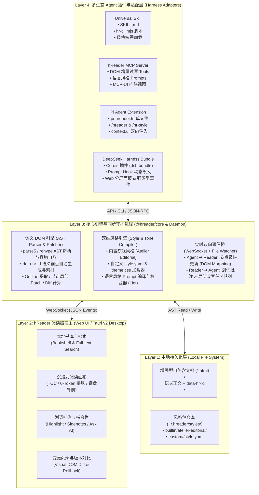
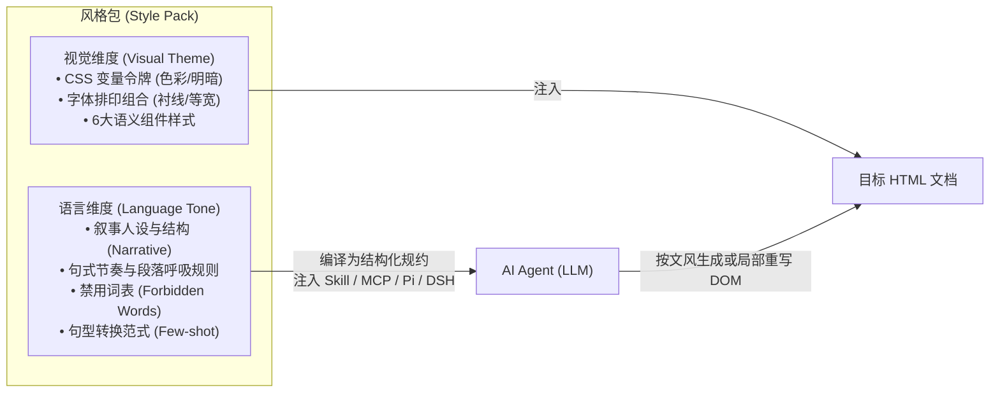
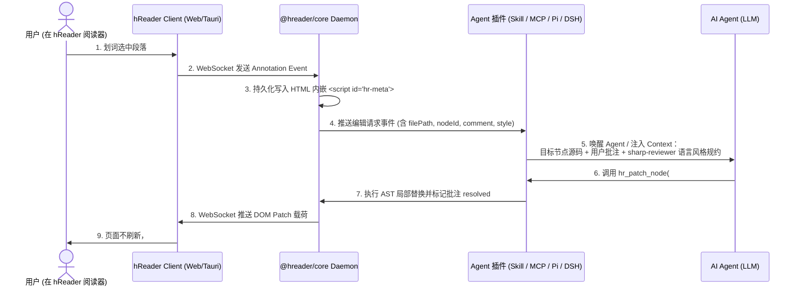

# hReader 总体架构设计兼演进路线图 (Architecture & Roadmap)

> [!IMPORTANT]
> 本文档基于 [01-competitor-research.md](file:///Users/liu/Documents/Project/hReader/docs/01-competitor-research.md) 的竞品调研结论，详细定义 **hReader** 的总体系统架构、自包含 HTML 文档规范、“视觉+语言”双维风格引擎、DOM 增量 Patch 协议、四大生态插件（Skill / MCP / Pi / DeepSeek Harness）的实现方案，以及分阶段演进路线图（Roadmap）。

---

## 一、 架构设计原则 (Architectural Principles)

1. **Local-First & 单文件自包含（Self-Contained HTML）**：
   每一篇由 hReader 生成或管理的 `.html` 文件都是合法的、标准的单文件网页。主题样式、语义组件、甚至用户的划词高亮与批注元数据均内嵌在文件内部，脱离 hReader 用普通浏览器也能完美打开。
2. **骨骼先行与手术刀式增量编辑（Skeleton-First & Surgical DOM Patch）**：
   彻底摒弃“修改一句话重写整个 HTML 文件”的低效模式。通过自动维护 `data-hr-id` 语义锚点，让 Agent 先读百字级 DOM 大纲骨骼，再对特定节点执行毫秒级局部 Patch。
3. **视觉主题与语言文风正交解耦（Orthogonal Visual & Language Styles）**：
   **视觉风格（Visual Theme）**由 CSS 变量与语义组件布局决定，支持在阅读器中 **0 Token 即时换肤**；**语言风格（Language Tone）**由结构化 Prompt 规约（人设、叙事结构、句式节奏、禁用词）决定，支持按章节驱动 Agent 局部重写润色。
4. **单核多端适配（Single Core, Multi-Harness Adapters）**：
   核心解析、DOM 修补与实时通信全部收敛于 `@hreader/core`，向上为 **Universal Skill、MCP、Pi Coding Agent、DeepSeek Harness (Cordis)** 提供零冗余的原生插件封装。

---

## 二、 总体系统架构全景图



---

## 三、 核心子系统详细设计

### 1. 自包含增强型 HTML 文档规范 (`hReader HTML Spec`)

为了兼顾“普通浏览器直接双击可读”与“hReader 深度交互与增量编辑”，我们定义标准化的单文件 HTML 结构：

```html
<!DOCTYPE html>
<html lang="zh-CN" data-hr-visual="atelier-editorial" data-hr-tone="feynman-tech">
<head>
  <meta charset="UTF-8" />
  <title>分布式一致性协议深度解析</title>
  <!-- 1. 视觉风格层：可由阅读器或引擎 0-Token 动态替换 -->
  <style id="hr-theme">
    :root { --hr-bg: #FAF8F5; --hr-fg: #1C1917; --hr-accent: #C84B31; /* ... */ }
    /* 内置响应式排版、Bento 卡片、Callout、Sidenotes 样式 */
  </style>
</head>
<body>
  <main class="hr-container">
    <article data-hr-id="root-article">
      <!-- 2. 语义块层：每个章节/组件拥有唯一稳定的 data-hr-id -->
      <header data-hr-id="sec-header">
        <h1 data-hr-id="title-main">分布式一致性协议深度解析</h1>
        <p class="hr-lead" data-hr-id="p-lead">从物理时钟的不可靠性出发，推演 Raft 与 Paxos 的本质同构。</p>
      </header>

      <section data-hr-id="sec-problem" data-hr-component="callout-warning">
        <h2 data-hr-id="h2-problem">为什么直觉上的“主从复制”一定会丢数据？</h2>
        <p data-hr-id="p-problem-1">假设网络发生分区...</p>
      </section>

      <section data-hr-id="sec-comparison" data-hr-component="kpi-bento">
        <!-- 语义化网格卡片或内联 SVG / Mermaid -->
      </section>
    </article>
  </main>

  <!-- 3. 内嵌元数据与批注层：普通浏览器自动忽略，hReader 读取并渲染为页边批注 -->
  <script id="hr-meta" type="application/json">
  {
    "version": "1.0",
    "style": { "visual": "atelier-editorial", "tone": "feynman-tech" },
    "annotations": [
      {
        "id": "ann-01",
        "targetId": "p-problem-1",
        "selectedText": "假设网络发生分区",
        "comment": "这里请用银行跨行转账的例子具象化解释一下脑裂问题",
        "status": "pending_ai",
        "createdAt": "2026-11-12T14:30:00Z"
      }
    ]
  }
  </script>
</body>
</html>
```

---

### 2. “视觉 + 语言”双维风格引擎 (`Dual-Axis Style Engine`)

风格引擎将**视觉表现（Visual）**与**语言文风（Language/Tone）**拆分为两个可独立配置、也可打包分发的维度：



#### (1) 内置默认风格：`Atelier Editorial`（工坊社论风）
* **内置视觉设计**：
  * **纸感与暗夜双模**：日间采用温暖羊皮纸白（`#FAF8F5`）与深炭墨黑，夜间自动切换为深曜石蓝灰（`#121316`），拒绝刺眼纯白与纯黑。
  * **黄金阅读人体工学**：正文区严格锁定 `68ch` 最佳阅读视宽，右侧预留 `280px` 边栏用于展示浮动目录与页边批注（Sidenotes）。
  * **7 个内置零配置语义组件（6 类，callout 含 insight/warning 两型）**（Agent 只需写 `data-hr-component="xxx"`）：
    1. `kpi-bento`：多维核心指标卡片网格
    2. `callout-insight / warning`：高辨识度洞察与警示框
    3. `split-compare`：左右双栏优劣/方案对比视图
    4. `deep-dive`：可折叠的底层细节/源码剖析手风琴框（`<details>` 增强）
    5. `step-timeline`：纵向编号流转步骤条
    6. `diagram-stage`：带缩放与图例说明的 SVG / Mermaid 画布容器
* **内置默认语言风格（社论深度剖析调性）**：
  * **结论先行（BLUF）**：每个 `<section>` 第一句必须给出明确判断，不绕圈子。
  * **反 AI 废话过滤器（Anti-Slop Lint）**：内置禁用词表（如“总而言之”、“在当今数字化时代”、“毋庸置疑”、“赋能”、“抓手”），引擎在 Patch 时甚至可对命中禁用词的段落向 Agent 发出重写警告。
  * **三段一视觉法则**：连续纯文字段落不得超过 3 段，第 4 段必须转化为对比表、列表卡片、引语或图表。

#### (2) 自定义语言风格定义规范 (`style.yaml`)
用户可在 `~/.hreader/styles/<style-id>/style.yaml`（或项目根目录 `.hreader/style.yaml`）中创建任意数量的自定义语言风格：

```yaml
id: sharp-reviewer
name: "毒舌架构师锐评风"
description: "一针见血指出设计缺陷，拒绝和稀泥，用工程数据说话"
inherits_visual: "atelier-editorial" # 继承内置社论视觉，也可指定自定义 theme.css

language_style:
  persona: "拥有 15 年分布式系统经验、极度讨厌过度设计的首席架构师"
  narrative_rules:
    - "开篇直接戳破方案中最脆弱的假设或性能瓶颈"
    - "凡是提到『高可用』『高性能』，必须追问或给出具体的延迟/吞吐量量级"
    - "对比竞品时明确给出『什么时候绝不要用它』的反面清单"
  sentence_rhythm:
    max_paragraph_sentences: 4
    style: "短句为主，多用设问与强对比，善用括号补充犀利吐槽"
  vocabulary:
    forbidden: ["赋能", "抓手", "闭环", "大概", "可能也许", "不仅...而且..."]
    recommended: ["权衡 (Trade-off)", "瓶颈", "单点故障", "代价是", "本质上"]
  examples:
    - bad: "该架构具有很好的扩展性，能够满足未来的业务需求。"
      good: "这套架构在 QPS 破万时状态同步会直接打满网卡——所谓的『高扩展性』前提是你得先忍受 30ms 的跨机房延迟。"
```

---

### 3. 语义 DOM 增量编辑协议 (`Semantic DOM Patch Protocol`)

为了支撑所有插件高效编辑 HTML，`@hreader/core` 提供以下 5 个核心原语（API / CLI / MCP Tools 一一对应）：

| 原语名称 | 输入参数 | Token 消耗与作用说明 |
| :--- | :--- | :--- |
| `hr_outline` | `filePath` | **~150 Tokens**。返回文档的 `<section>` / `<h1~h4>` 骨骼树、各节点 `data-hr-id`、字数统计、以及**所有未处理的 `pending_ai` 用户划词批注**。 |
| `hr_read_node` | `filePath`, `nodeId` (或 CSS Selector) | **~200 Tokens**。仅提取目标节点及其子树的 HTML 源码与关联批注，避免读取整篇文件。 |
| `hr_patch_node` | `filePath`, `nodeId`, `action` (`replace` \| `insert_after` \| `insert_before` \| `append` \| `delete`), `htmlContent` | **极速局部写入**。解析 HTML 片段，自动为新增块级元素注入 `data-hr-id`，校验标签闭合与禁用词，更新文件并触发 WebSocket 局部热更新。 |
| `hr_apply_style` | `filePath`, `visualId?`, `toneId?` | 若仅切换 `visualId`，引擎直接替换 `<style id="hr-theme">`（**0 LLM Token**）；若切换 `toneId`，返回该语言风格的完整规约供 Agent 改写正文。 |
| `hr_resolve_annotation` | `filePath`, `annotationId`, `resolutionNote?` | 将 `<script id="hr-meta">` 中对应的用户批注标记为 `resolved`，阅读器界面自动将该批注归档并高亮显示修改后的段落。 |

---

### 4. 四大生态插件实现方案 (Ecosystem Adapters)

#### 交互时序图：从阅读器划词批注到 Agent 局部增量更新



#### ① Universal Skill (`packages/skill`)
* **目录结构**：
  ```text
  hreader-skill/
  ├── SKILL.md                  # 触发规则、工作流指令、6大内置组件 HTML 速查表
  ├── scripts/
  │   └── hr.mjs                # 零配置 CLI 封装 (支持 outline / read / patch / style / serve)
  └── references/
      ├── components-spec.md    # 详细组件 DOM 结构范例
      └── style-authoring.md    # 指导 Agent 帮用户采访并生成自定义 style.yaml 的指南
  ```

#### ② MCP Server (`packages/mcp-server`)
* 基于 `@modelcontextprotocol/sdk` 构建，支持 `stdio` 与 `SSE/Streamable HTTP`。
* 除了暴露上述 5 个核心 DOM 编辑 Tool 外，还将 `~/.hreader/styles/` 下的所有风格动态注册为 **MCP Resources (`hreader://styles/{id}`)** 与 **MCP Prompts (`use-hreader-style`)**。
* 支持 **MCP-UI**：当调用 `hr_create_doc` 或 `hr_patch_node` 时，返回 `_meta.ui.resourceUri`，在支持 MCP-UI 的宿主内直接弹出内联阅读视图。

#### ③ Pi Coding Agent 插件 (`packages/pi-extension/pi-hreader.ts`)
* 严格遵循 Pi (`@earendil-works/pi-coding-agent`) 的单文件 TypeScript 扩展哲学：
  * **注册命令**：
    * `/hreader [path]`：拉起本地 hReader 阅读视图并开启双向监听。
    * `/hr-style [tone-id]`：切换当前 Pi 会话绑定的语言风格与视觉主题。
  * **注册工具**：向 Pi 暴露 `hreader_outline`、`hreader_read_node`、`hreader_patch_node`。
  * **终端与阅读器联动**：订阅本地 Daemon 的 **SSE** 事件流（`GET /api/events`，`cookie` 认证 + `Last-Event-ID` 回填 + 心跳帧；M2.1 决定用 SSE 而非 WebSocket，见 `packages/core/src/server/event-ring.ts`）；事件到达后按需拉取批注（`GET /api/doc/:docId/annotations`），有新条目时调用 `ctx.ui.confirm` / `ctx.ui.notify` 提示用户，把节点源码与批注组装成消息注入 Pi 上下文（`pi.sendUserMessage` / `pi.sendMessage`）。

#### ④ DeepSeek Harness 插件 (`packages/dsh-bundle`)
* 深度适配 **DeepSeek Harness (`dsh`)** 的 **Cordis** 微内核架构：
  * **插件清单 (`package.json` & `cordis.patch.yml`)**：声明 `dsh.bundle` 入口，支持通过 `dsh plugin add @hreader/dsh-bundle` 无侵入安装。
  * **Cordis 服务注册**：在 `ctx.provide('hreader')` 中挂载核心引擎实例，利用 Cordis 的 `ctx.on('dispose', ...)` 实现优雅的可逆卸载（Reversible Effects）。
  * **事件总线与自动接管**：
    * 监听 DSH 的模型输出流或工具调用事件；当挂载了某款 `hreader` 语言风格 Profile 时，通过 Cordis 的 Prompt Interceptor 动态向 System Prompt 织入该风格的 `language_style` 规约。
    * 提供 `dsh-web-app` 前端面板扩展：在 DSH 的 Web 工作台中直接增加一个 **hReader Tab**，用户在 Tab 内划词点击“AI 重写”时，派发强类型事件 `ctx.emit('hreader/patch-request', payload)`，直接触发 DSH Agent Loop 执行局部修补。

---

### 5. hReader 阅读器宿主设计 (`packages/reader-client`)

阅读器采用 **Web UI + Tauri v2 外壳** 双栖架构（当前阶段只做 Web：`packages/app`，无 bundler、无框架，由 daemon 静态托管；Tauri 外壳留待后期）（同一套前端代码，既可由本地 Daemon 通过 `http://localhost:4321` 在任意浏览器/IDE Webview 中打开，也可编译为约 8MB 的 macOS/Windows/Linux 原生桌面 App）：

* **左栏：书库与语义大纲（Library & Outline）**
  * 自动扫描工作区或本地归档目录中的 `.html` 文档，按标签与阅读状态分类。
  * 实时展示当前文档的多级目录树（TOC），并标注哪些章节含有未处理的批注（📌）或刚刚被 AI 更新过（✨）。
* **中栏：沉浸式画布（Reader Canvas）**
  * 顶部悬浮控制条：**视觉风格下拉切换器**（实时预览切换 `Atelier Editorial`、`Blueprint`、`Paper` 等主题，无需 AI 重新生成）、明暗模式、字号/行宽/行距调节。
  * 键盘流支持：`j` / `k` 在各个 `data-hr-id` 语义块之间平滑跳转聚焦，`h` 高亮当前块，`c` 对当前块添加批注并唤醒 AI。
* **右栏：旁注与 Diff 审阅栏（Sidenotes & Diff Review）**
  * 仿纸质书页边留白设计，所有划词批注与高亮紧贴对应段落右侧对齐显示。
  * 当 Agent 通过 `hr_patch_node` 修改了某个段落后，支持一键切换 **Visual Diff 模式**（直观对比修改前后的文字/排版差异，点击 `Accept` 确认或 `Revert` 毫秒级回滚）。

---

## 四、 拟建工程目录结构 (Monorepo Structure)

建议在 `/Users/liu/Documents/Project/hReader` 下采用 `pnpm workspace` 组织轻量级 TypeScript Monorepo：

```text
hReader/
├── docs/
│   ├── 01-competitor-research.md       # 竞品全景调研报告
│   └── 02-architecture-and-roadmap.md  # 总体架构设计兼路线图 (本文档)
├── styles/                             # 内置风格包仓库
│   ├── atelier-editorial/              # 默认旗舰风格 (style.yaml + theme.css)
│   ├── feynman-tech/                   # 预设语言风格：费曼技术解构风
│   └── executive-brief/                # 预设语言风格：高管精炼简报风
├── packages/
│   ├── core/                           # @hreader/core: AST解析、DOM Patch、风格引擎、WS Daemon
│   ├── cli/                            # @hreader/cli: 命令行工具 (hr outline/patch/serve/style)
│   ├── app/                            # @hreader/app: 阅读器前端（TS 直出 ESM，无 bundler；运行时依赖按需引入，见 §依赖策略）
│   ├── desktop/                        # @hreader/desktop: Tauri v2 桌面端外壳 (后期按需开启)
│   ├── mcp-server/                     # @hreader/mcp: 标准 MCP Server (含 MCP-UI)
│   ├── pi-extension/                   # pi-hreader.ts: Pi Coding Agent 单文件扩展
│   └── dsh-bundle/                     # @hreader/dsh-bundle: DeepSeek Harness Cordis 插件包
└── skills/
    └── hreader/                        # Universal Skill (SKILL.md + references + scripts)
```

---

## 依赖策略（2026-11-14 用户裁定，取代"零依赖手搓"）

- **默认按需引入成熟库**：能用成熟开源库直接解决的问题，优先用库；手搓只保留在"引入库的风险大于收益"的场合（体积、许可、原生依赖、维护停滞）。
- **已手搓的模块允许替换**（例如 `packages/core/src/annotations/diff.ts` 的手写 LCS → 成熟 diff 库）：走**单独的重构卡**，分批替换，不夹在功能卡里；未结的卡先收口，不许在卡中途推翻已过审的实现。
- **需先确认的两类**：①前端运行时依赖（`@hreader/app` 目前无 bundler）；②底层核心架构替换（框架 / 打包器 / AST / 解析引擎）。选型方案须列出候选、体积、维护活跃度、替换成本、回退方案。
- **可自行引入**：Node 服务端与测试侧的轻量成熟库（HTTP 工具、diff、测试辅助、fuzz 生成器…），在卡片里登记"引了什么、为什么、替代了什么手搓代码"即可。
- **门禁不变**：`knip` 不得有"装了没用"的依赖，`dependency-cruiser` 层次规则不得破窗，`perFile` 四维 100% 不放宽。

## 五、 分阶段演进路线图 (Phased Roadmap)

我们将研发计划拆分为 **4 个递进里程碑（Milestones）**，确保每个阶段都有可直接使用的闭环产物：


### Milestone 1：核心底座、双维风格引擎与 Universal Skill（MVP 闭环）
* **目标**：让任何支持 CLI / Skill 的 Agent 都能生成具有 `Atelier Editorial` 出版级质感的自包含 HTML，并支持自定义语言风格与命令行增量 Patch。
* **核心任务**：
  - [x] **M1.1 自包含 HTML 规范与 `@hreader/core` AST 引擎**：基于 `parse5` / `rehype` 实现 `data-hr-id` 自动注入、`hr_outline` 骨骼提取、`hr_read_node` 与 `hr_patch_node` 原子操作。
  - [x] **M1.2 双维风格引擎与默认风格包**：完成内置视觉主题 `Atelier Editorial`（含明暗双模与 6 大语义组件 CSS）及 `style.yaml` 自定义语言风格解析器（含禁用词 Lint 校验）。
  - [x] **M1.3 CLI 与 Universal Skill (`skills/hreader/SKILL.md`)**：封装 `hr` 命令行工具与 `SKILL.md`，在 Claude Code / Antigravity 中跑通“按指定语言风格生成 HTML ➔ 骨骼读取 ➔ 局部节点重写”全流程。

### Milestone 2：hReader 阅读器宿主与“划词即指令”双向同步
* **目标**：告别系统浏览器的简陋预览，提供真正的沉浸式阅读器界面，打通“阅读器划词批注 ➔ Agent 局部更新 ➔ 页面无感热刷新”闭环。
* **核心任务**：
  - [x] **M2.1 本地 Daemon 与 SSE 同步桥**：在 `@hreader/core` 中内置轻量 HTTP 服务（`node:http`），服务端推送走 SSE、客户端命令走 POST，监听文件变更与前端批注事件。
    > 与初版计划的差异：原计划用 WebSocket。自实现 RFC 6455 需处理掩码、分片与关闭握手，属于「能写对但很容易写错」的面；SSE 只有行协议且 `EventSource` 自带重连，语义等价。裁定见 `.workflow/cards/M2.1.md` §1 D3。
    > 超时全部用 Node 内置三档（`headersTimeout` / `requestTimeout` / `keepAliveTimeout`）：超限时由解析器收尾（**不再由服务端手写 408 帧**），头部/半截请求直接关连接。成帧不合规（重复 `Content-Length`、`Transfer-Encoding` 与 `Content-Length` 并存、非 `chunked` 的 TE）由 Node 解析器先拒，客户端拿到裸 `400`/`431`/`501`，**没有 JSON 体**。
    > **事件环只存事件、不带文档实体**（非目标，P2-D）：环形缓冲容量固定为 256，若把节点/段落实体塞进去，内存上界就跟着文档大小走；代价是客户端在 `doc.changed` 后需要一次 `GET /api/doc/<id>/model` 取内容，换取**与文档大小无关的内存上界**。
  - [x] **M2.2 阅读器核心界面 (`@hreader/app`)**：实现左栏书库与动态 TOC、中栏沉浸画布（0-Token 视觉主题实时切换、字号/行宽调节、`j`/`k` 键盘导航）、右栏页边批注（Sidenotes）。
  - [x] **M2.3 划词批注持久化与 Visual Diff**：实现划词高亮/批注自动写入 HTML 内嵌 `<script id="hr-meta">`，以及 Agent 局部 Patch 后的节点闪烁高亮与一键 Undo 回滚。

### Milestone 3：MCP、Pi 与 DeepSeek Harness 全生态插件适配
* **目标**：将 `@hreader/core` 与阅读器能力无缝接入主流 Agent 框架。
* **核心任务**：
  - [x] **M3.1 `@hreader/mcp-server`**：实现标准 MCP Tools、语言风格 Prompts 注册，并兼容 `MCP-UI` 内联资源协议。
  - [x] **M3.2 Pi 插件 (`pi-hreader.ts`)**：编写单文件 TypeScript 扩展，实现 `/hreader`、`/hr-style` 命令及阅读器批注向 Pi `context.ui` 的自动投递。
  - [ ] **M3.3 DeepSeek Harness 插件 (`@hreader/dsh-bundle`)**：基于 Cordis 编写插件入口与 `cordis.patch.yml`，实现语言风格 Prompt Hook 动态织入、强类型事件触发 Agent Loop 局部修补、以及 `dsh-web-app` 内嵌阅读面板。
  - [ ] **M3.4 `hr_undo` 工具**：给 MCP 层补撤销入口（前端与 HTTP 早已有 `undoPatch`，MCP 缺一个工具）。2026-11-15 用户裁定从 M3.1 拆出，避免撑爆单卡验收范围。

### Milestone 4：Tauri v2 独立桌面端与“AI 风格萃取工坊”
* **目标**：完善独立桌面软件体验，降低用户编写自定义语言风格的门槛。
* **核心任务**：
  - [ ] **M4.1 AI 语言风格萃取器 (`hr style extract`)**：用户只需丢入 3~5 篇自己喜欢的历史文章或博客，Agent 自动分析其句式节奏、常用转折词、叙事结构与高频词汇，一键生成专属的 `style.yaml`。
  - [ ] **M4.2 Tauri v2 跨平台桌面应用 (`@hreader/desktop`)**：打包 macOS / Windows / Linux 原生安装包，支持系统级全局快捷键呼出与 `.html` 文件关联打开。
  - [ ] **M4.3 出版级导出工具链**：优化 `@media print` 样式，支持一键导出带目录书签的精美 PDF 与社交媒体高清长图。

### 已知非目标：片段校验里"不拦"的两类输入（v3 裁定，2026-11-13）

`hr_patch_node` 的片段拒绝名单只覆盖**可执行面**。下面两类在评审中被提出，但**明确不拦**，理由是它们不具备执行能力，拦了反而误杀正常正文：

* `<xmp>…</xmp>` / `<plaintext>` 等 raw-text 容器：内容按 HTML 规范**不再解析**，里面的 `` 只是字面文本，不会生成可执行节点。
* `style="…url(javascript:…)"`：现代引擎不执行 CSS 里的 `javascript:` 协议（`url()` 只用于取图），且 `style` 是合法排版输入。

与之相对，**元素级 URL 属性**（`href`/`src`/`xlink:href`）与**SVG 动画子元素对这些属性的改写**（`<set attributeName="href" to="javascript:…">`，v3#16）一律拒绝——它们的执行路径是真实存在的，也是历史上最常见的绕过面。
